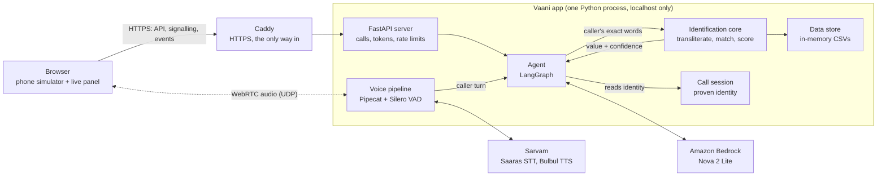
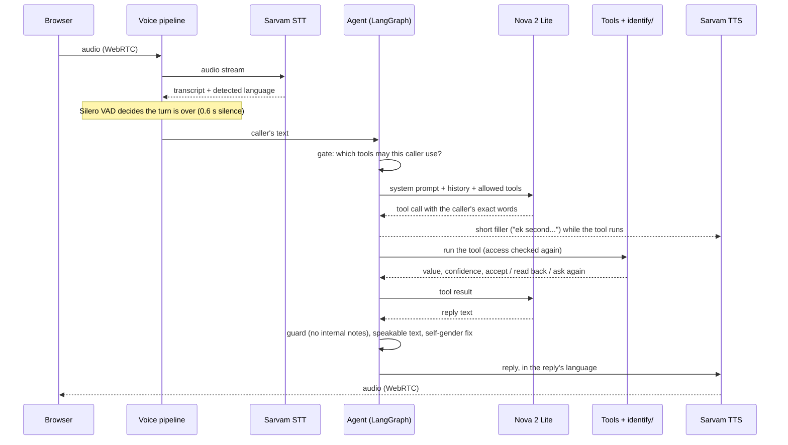

# Vaani: technical guide

How Vaani is built: architecture, backend, AI agent, voice pipeline,
identification core, data, frontend, security, testing and deployment. For
what the product does and why the name matcher works the way it does, see the
[product overview](docs/vaani-overview.html). For setup, see the
[README](README.md).

## Contents

1. [Stack at a glance](#1-stack-at-a-glance)
2. [System architecture](#2-system-architecture)
3. [Repository layout](#3-repository-layout)
4. [Backend (FastAPI)](#4-backend-fastapi)
5. [The AI agent (LangGraph + Nova)](#5-the-ai-agent-langgraph--nova)
6. [Voice pipeline (Pipecat + Sarvam)](#6-voice-pipeline-pipecat--sarvam)
7. [Identification core](#7-identification-core)
8. [Data layer](#8-data-layer)
9. [Frontend (React)](#9-frontend-react)
10. [Security model](#10-security-model)
11. [Configuration](#11-configuration)
12. [Testing and evaluation](#12-testing-and-evaluation)
13. [Build and deployment](#13-build-and-deployment)
14. [Limits and known gaps](#14-limits-and-known-gaps)

---

## 1. Stack at a glance

| Layer | Technology | Where |
| --- | --- | --- |
| Frontend | React 19, TypeScript, Vite 8, Pipecat client (WebRTC) | `web/` |
| Web server | FastAPI on Uvicorn, Python 3.12+ (3.13 in Docker) | `server/` |
| Agent | LangGraph tool-calling loop | `agent/` |
| LLM | Amazon Nova 2 Lite on Bedrock (`global.amazon.nova-2-lite-v1:0`, ap-south-1) via `langchain-aws` | `agent/llm.py` |
| Speech to text | Sarvam Saaras v4, streaming over WebSocket | `voice/pipeline.py` |
| Text to speech | Sarvam Bulbul v3, voice "roopa" | `voice/pipeline.py` |
| Real-time voice | Pipecat 1.12, SmallWebRTC transport, Silero VAD | `voice/` |
| Identification | Own code: transliteration, phoneme matching, spoken numbers, dates and IDs | `identify/` |
| Data | CSV files loaded into memory; no database | `core/store.py`, `data/` |
| Hosting | Docker, Caddy (automatic HTTPS) | `Dockerfile`, `docker-compose.yml`, `deploy/` |
| Tests | pytest, pytest-asyncio, httpx; ruff for linting | `tests/`, `eval/` |

Pinned Python dependencies are in [requirements.txt](requirements.txt), and dev
tools are in [requirements-dev.txt](requirements-dev.txt).

---

## 2. System architecture



Three facts shape the design:

- **One process holds everything.** Sessions, rate limits and records created
  during calls live in memory. That keeps the demo simple, and every stateful
  part sits behind a small interface (`SessionManager`, `SlidingWindow`,
  `Store`) that Redis or a database could replace.
- **Audio bypasses Caddy.** Caddy carries HTTPS: the API, WebRTC signalling and
  the event stream. Audio flows over WebRTC (UDP) directly between the browser
  and the voice pipeline.
- **The LLM finds; code decides.** The model picks out what the caller said and
  passes those exact words to a tool. The identification core normalises,
  matches and scores them. The model never decides that a value matched.

### One voice turn, end to end



If the caller talks over Vaani, Pipecat raises an interruption: the pending
reply is cancelled and the new turn starts (barge-in).

---

## 3. Repository layout

```
vaani-6/
├── agent/            the AI agent
│   ├── graph.py        LangGraph loop: gate -> model -> tools, limits, reply guard
│   ├── tools.py        25 tools with access rules, argument models, audit
│   ├── prompts.py      system prompt, rebuilt on every model call
│   ├── persona.py      voice gender, fillers, read-aloud cleanup
│   └── llm.py          Bedrock client (Nova), retries and timeouts
├── core/             shared infrastructure
│   ├── config.py       all settings (pydantic-settings, .env)
│   ├── session.py      CallSession: identity, OTP, lockout, event stream
│   ├── store.py        in-memory "system of record" loaded from CSVs
│   ├── masking.py      PII masking for logs and audit
│   └── audit.py        JSON-lines audit trail of every tool call
├── identify/         the identification core (no AI)
│   ├── translit.py     Devanagari / Tamil -> phonetic Roman
│   ├── phonetic.py     phoneme-weighted edit distance
│   ├── matchers.py     Levenshtein, Metaphone and phoneme matchers, one interface
│   ├── resolve.py      names, districts, pincodes, DOBs, amounts -> EntityResult
│   ├── numbers.py      spoken numbers in English, Hindi, Marathi, Tamil
│   ├── dates.py        spoken dates, including relative ones ("pichhle mahine")
│   ├── ids.py          phone, pincode, OTP, PIN, loan / employee / ticket IDs
│   └── result.py       EntityResult and Candidate: one shape for every value
├── voice/            real-time voice
│   ├── pipeline.py     Pipecat pipeline: WebRTC, STT, VAD, agent bridge, TTS
│   └── language.py     reply language from script, for the TTS voice
├── server/           web server
│   ├── app.py          routes, middleware, security headers, WebRTC signalling
│   ├── ratelimit.py    sliding windows and the daily call budget
│   ├── logs.py         masked logging (std logging and Pipecat's loguru)
│   └── __main__.py     `python -m server`
├── web/              frontend (React + Vite)
│   └── src/
│       ├── App.tsx         app shell, access gate, call lifecycle
│       ├── api.ts          REST client and the live event WebSocket
│       ├── voice.ts        Pipecat WebRTC client (loaded only for voice calls)
│       ├── score.ts        scores a call against the scenario's expectations
│       ├── types.ts        config, scenario and event types
│       └── components/     Phone, ScenarioDrawer, Inside (the live panel)
├── data/
│   ├── generated/      synthetic NBFC data (customers, loans, EMIs, tickets, staff, branches)
│   ├── reference/      India Post districts and pincodes, names, place aliases, sound confusions
│   └── scenarios/      50 test scenarios (25 customer, 25 staff), YAML
├── eval/             evaluation scripts and results
├── scripts/          data generation, reference build, Bedrock check, voice audition
├── tests/            pytest suite (201 tests)
├── deploy/           EC2 guide and Caddyfile
├── docs/             product overview (HTML and Word)
├── Dockerfile, docker-compose.yml
└── requirements.txt, requirements-dev.txt, pyproject.toml, .env.example
```

---

## 4. Backend (FastAPI)

[server/app.py](server/app.py) builds the app with `create_app(settings, model,
store)`. The model and store are injectable, so tests run without AWS.

### API

| Method | Path | Auth | Purpose |
| --- | --- | --- | --- |
| GET | `/healthz` | none (blocked at Caddy) | Health check for Docker |
| POST | `/api/login` | none (failures rate-limited) | Check user ID and password; set the sign-in cookie |
| POST | `/api/logout` | sign-in | End the sign-in |
| GET | `/api/config` | sign-in for details | Signed-in user, voice availability, demo date, limits, ICE servers. Signed out, it only says `signed_in: false`. |
| GET | `/api/scenarios` | sign-in | The 50 scenarios |
| POST | `/api/calls` | sign-in | Start a call owned by the signed-in user; returns `call_id` and a bearer token |
| POST | `/api/calls/{id}/turn` | sign-in + call token | One typed turn; returns the reply |
| POST | `/api/calls/{id}/end` | sign-in + call token | Hang up |
| WS | `/api/calls/{id}/events` | call token, sent as the first message | Live event stream for the panel |
| POST | `/api/calls/{id}/offer` | call token | WebRTC offer (start voice, or renegotiate this call's own peer) |
| PATCH | `/api/calls/{id}/offer` | call token | ICE candidates for this call's peer |
| GET | `/{path}` | none | The built frontend (`web/dist`) |

API docs (`/docs`, `/openapi.json`) exist only in development.

### Request handling

- **Middleware** (`guard`): rejects bodies over `MAX_BODY_BYTES` before reading
  them, applies the per-IP request limit to `/api/*`, turns unhandled errors into
  a plain 500, and adds security headers to every response.
- **TrustedHostMiddleware**: answers only to `ALLOWED_HOSTS`.
- **Errors**: `SessionError`, `HTTPException` and validation errors all become
  `{"error": "..."}` with no stack traces or internals.
- **Client IP**: the socket address, or the right-most `X-Forwarded-For` entry
  when `TRUST_PROXY=true` (the hop Caddy added, which a client cannot spoof).
- **Janitor**: a background task expires idle sessions every 30 seconds and
  disconnects their WebRTC peers.

### Sessions

[core/session.py](core/session.py). A `CallSession` holds everything that
decides what the caller may see:

- Line (`customer` or `staff`), proven identity (`customer_id` only after the
  OTP; `staff_id` and `staff_role` after employee ID and PIN).
- The OTP, stored only as a salted PBKDF2 hash, with a 5-minute expiry and 3
  attempts. At most 3 OTPs per call.
- Verification failures: 3 lock the call.
- Conversation history for the agent, and a turn lock so turns never overlap.
- An event backlog (400 events) and subscriber queues for the live panel.
  `emit()` never blocks; a slow browser loses events, the call carries on.

`SessionManager` creates sessions (random 64-bit ID, 256-bit token stored as a
SHA-256 hash), authenticates in constant time, enforces open-session caps (total
and per IP) and expires idle sessions.

### Sign-in

[server/users.py](server/users.py) holds `USERS`, a dictionary of user ID to
password hash. There is no sign-up and no user database: you decide who gets
in by editing that file.

```bash
python -m server.users interviewer     # asks for the password, prints the line
```

```python
USERS = {
    "interviewer": "pbkdf2_sha256$600000$<salt>$<hash>",
}
```

[server/auth.py](server/auth.py) keeps sign-in sessions in memory: a random
token in an HttpOnly, SameSite=Strict cookie, stored only as a SHA-256 hash.
Every API route except `/api/login` and `/api/config` needs it, the event
WebSocket included, and every call belongs to the user who started it.
Deleting a user from `USERS` ends their access on the next request; a restart
signs everyone out.

### Rate limits

[server/ratelimit.py](server/ratelimit.py): in-memory sliding windows keyed by
client, plus a daily call budget that resets at midnight UTC. Limits: requests
per IP per minute, new calls per IP per hour, failed sign-ins per 15 minutes
(per IP, and three times that per user ID), typed turns per call per minute, WebRTC offers per IP per minute, and
event-stream connections per IP per minute.

---

## 5. The AI agent (LangGraph + Nova)

### The graph

[agent/graph.py](agent/graph.py):

```
START -> gate -> model -> (tool calls?) -> tools -> gate -> model -> ... -> END
```

- **gate** works out which tools this caller may use right now, from the session
  (verified or not, line, staff role). The model is bound only to those tools.
- **model** calls Nova with a system prompt rebuilt on every call
  ([agent/prompts.py](agent/prompts.py)), so it always reflects the current
  verification state.
- **tools** runs each tool call in a worker thread, so the audio loop stays
  responsive. Each tool checks access again before it runs.

### Limits

| Limit | Value |
| --- | --- |
| Tool calls per model step | 4 |
| Graph steps per caller turn (recursion limit) | 16, about 5 model calls |
| History kept | last 40 messages, cut at a caller turn so tool calls stay paired |
| Turn timeout | 3 × `LLM_TIMEOUT_SECONDS` (60 s by default) |
| Model settings | temperature 0.2, max 350 tokens, adaptive retries (3 attempts) |
| Turns per call | 60 |

A failed turn (throttling, timeout, model error) never raises: the caller hears
a short apology in their language and can try again.

### Tools

[agent/tools.py](agent/tools.py) defines 25 tools. Each declares when it is
available; the executor checks again before running it, validates arguments
with Pydantic, counts writes against a per-call cap, audits the call and emits
it to the live panel. A tool that throws is logged and reported to the model as
an error instead of ending the turn.

| Available | Tools |
| --- | --- |
| Anyone | `identify_value`, `find_branch`, `escalate_to_human`, `report_fraud`, `end_call` |
| Customer, before verification | `verify_customer` (name + DOB, mobile or loan ID; sends the OTP) |
| Customer, OTP pending | `check_otp` |
| Verified customer | `get_loan_status`, `get_emi_schedule`, `get_foreclosure_quote`, `list_pending_documents`, `explain_rejection`, `create_service_request`, `raise_complaint`, `check_ticket` |
| Staff, before login | `verify_staff` (employee ID + PIN) |
| Any logged-in staff | `lookup_case`, `diagnose_case`, `add_case_note`, `escalate_case`, `notify_customer`, `count_cases` |
| Ops, credit, supervisor | `retry_bureau_pull`, `queue_status` |
| Ops, supervisor | `set_priority` |

Rules every tool follows:

1. Arguments are what the caller **said** ("teis April unnees sau sattaasi"),
   never values the model worked out.
2. Who the caller is comes from the session, never from arguments. A customer
   tool only ever reads the verified customer's own loans.
3. Customers get customer wording (`customer_loan_view`); internal notes exist
   only in staff views.

### Persona and speech output

[agent/persona.py](agent/persona.py):

- **Gender from the voice**: Vaani's grammatical gender follows the TTS voice.
  A safety net rewrites first-person Hindi forms ("sakta hoon" to "sakti hoon",
  "karunga" to "karungi") in both Devanagari and Roman.
- **Fillers**: while a lookup tool runs, Vaani says something short, at most
  once per turn, on voice calls only.
- **Speakable text**: strips markdown, bullets, emoji and brackets, turns
  separators into pauses, and converts native digits, so TTS reads naturally.
  Dates are spoken as "5 November 2026" and money as ₹19,499.
- **Reply guard**: on the customer line, a reply containing any internal case
  note is replaced with a refusal, even if the model ignored its instructions.

---

## 6. Voice pipeline (Pipecat + Sarvam)

[voice/pipeline.py](voice/pipeline.py) builds one Pipecat pipeline per call:

```
WebRTC in -> Sarvam STT -> LanguageTap -> user aggregator (Silero VAD)
  -> AgentBridge -> Sarvam TTS -> WebRTC out -> assistant aggregator -> MetricsTap
```

| Stage | What it does |
| --- | --- |
| SmallWebRTC transport | Audio in and out of the browser; one peer per call, bound to the call's token |
| Sarvam STT (`saaras:v4`) | Streaming speech to text with language detection, including code-mixed speech |
| LanguageTap | Records the detected language on the session; emits what was heard to the panel |
| Silero VAD | Decides when the caller has finished (0.6 s of silence) |
| AgentBridge | Runs `agent.turn()` for each finished turn; cancels the pending reply on interruption; switches TTS language when the reply's script changes |
| Sarvam TTS (`bulbul:v3`) | Speaks the reply; voice, pace and temperature come from settings |
| MetricsTap | Sends speech-service time-to-first-byte to the panel |

[voice/language.py](voice/language.py) picks the TTS language from the reply's
script: Devanagari is Marathi if the caller speaks Marathi, otherwise Hindi;
Tamil, Telugu, Bengali and the other Indian scripts map to their own codes;
Latin text is Indian English.

Each voice call has a hard time limit (10 minutes, with a spoken goodbye) and an
idle timeout (90 seconds of silence). Concurrent voice calls are capped (3 by
default), which also keeps usage inside Sarvam's concurrency limits. Without a
`SARVAM_API_KEY` the app runs in typing mode: same agent, same tools, same panel.

---

## 7. Identification core

[identify/](identify/) is plain Python with no model, so the same input always
gives the same result. Every function returns an `EntityResult`
([identify/result.py](identify/result.py)):

```python
EntityResult(kind, heard, value, confidence, normalised, candidates, issues)
# .action -> "accept" | "read_back" | "ask_again", from the confidence
```

| Module | Handles |
| --- | --- |
| `translit.py` | Devanagari and Tamil to phonetic Roman, with Hindi schwa deletion and Tamil intervocalic voicing |
| `phonetic.py` | Sounds with articulatory features; weighted edit distance with a confusion table (`data/reference/confusions.csv`); two-word names compared in both orders |
| `matchers.py` | Levenshtein, Metaphone and phoneme matchers behind one interface, for evaluation |
| `resolve.py` | Names, districts (with pincode cross-check), pincodes, DOBs, event dates, amounts; confidence from best distance and lead over the runner-up |
| `numbers.py` | Spoken numbers in English, Hindi, Marathi and Tamil, as digit strings (phones, OTPs) or values (amounts: "do lakh pachaas hazaar" = 250000); fuzzy word matching lowers confidence |
| `dates.py` | DOBs ("teis April unnees sau sattaasi" = 1987-04-23, day-month-year) and relative dates ("pichhle mahine ki paanch tareekh", "kal", "3 din pehle"); "kal" returns both yesterday and tomorrow without a tense hint |
| `ids.py` | Phone, pincode, OTP, PIN, loan / employee / ticket IDs, including spoken letters ("el en eleven" = LN00011, medium confidence because zeros were assumed) |

Thresholds (name distance): high at 0.8 or less with a lead of 1.0, medium at
1.8 or less with a lead of 0.4, otherwise low. Places use 0.8 and 1.6. The
[product overview](docs/vaani-overview.html) explains the matcher in detail,
with worked examples and evaluation results.

---

## 8. Data layer

**There is no database.** [core/store.py](core/store.py) loads the CSVs in
`data/generated/` into dictionaries at startup. Records created during calls
(tickets, service requests, case notes, priority changes) live in memory until
restart, capped at 10,000 writes per process and 15 per call. All writes go
through a lock. A production deployment would put a database behind the same
`Store` methods.

### Synthetic NBFC data (`data/generated/`)

Generated by [scripts/generate_data.py](scripts/generate_data.py) and checked
for consistency by [tests/test_data.py](tests/test_data.py).

| File | Rows | Contents |
| --- | --- | --- |
| `customers.csv` | 300 | ID, full name, name in native script, gender, DOB, phone, pincode, district, state, language |
| `loans.csv` | 341 | 5 products, 9 stages from Applied to Closed, amounts, EMI, internal note (staff only), customer message, NACH and NOC status, overdue, SLA, owner |
| `emi_schedule.csv` | 3,978 | Each installment: due date, principal / interest split, status (paid, bounced, upcoming), bounce charge |
| `tickets.csv` | 151 | Complaints and requests, status, follow-ups |
| `staff.csv` | 20 | Employee ID, role (agent, credit, ops, supervisor), branch, PIN |
| `branches.csv` | 202 | One branch in each of 202 districts, with phone and pincode; other districts are not serviceable |

Some records are planted on purpose for the scenarios (the `planted` column
says why): sound-alike customers such as Mohan, Rohan and Sohan Verma, and
stuck cases with known blockers. Seven DOBs are shared by more than one
customer.

### Reference data (`data/reference/`)

| File | Rows | Source / purpose |
| --- | --- | --- |
| `pincodes.csv` | 19,486 | India Post pincode directory: pincode to district and state |
| `districts.csv` | 745 | Every district, built by [scripts/build_reference.py](scripts/build_reference.py) |
| `place_aliases.csv` | 35 | Common city names and old names (Bangalore, Trichy) mapped to districts |
| `names.csv` | 241 | Indian first names and surnames in Roman, ITRANS and Tamil, used to generate customers |
| `confusions.csv` | 20 | Sound pairs that Indian speech and spelling routinely mix up, with a cost and a reason |

### Scenarios (`data/scenarios/`)

50 YAML files written by [scripts/make_scenarios.py](scripts/make_scenarios.py):
25 on the customer line, 25 on the staff line. Each gives the tester a persona,
a goal, the turns to say (in the persona's language), a harder variant, and what
must happen:

```yaml
id: C01
line: customer
language: hi
persona: {customer_id: C0001, name: Rohan Verma, dob: '1991-03-14', ...}
goal: Find out where your loan application is.
turns:
  - Mera loan ka status kya hai?
  - Verma Rohan
  - Meri date of birth chaudah march unnees sau ikyaanave
  - '{otp}'
expected:
  entities: {customer_id: C0001, dob: '1991-03-14'}
  tools: [verify_customer, check_otp, get_loan_status]
  must_not: [Income proof insufficient for requested amount]   # an internal note
```

---

## 9. Frontend (React)

A single-page app in [web/](web/), built with Vite into `web/dist` and served
by FastAPI.

| File | Role |
| --- | --- |
| `App.tsx` | App shell: sign-in screen, header with theme toggle, loading config and scenarios, the call lifecycle (dial, text turns, hang up), event handling |
| `api.ts` | REST client (the sign-in cookie travels by itself; adds `Authorization: Bearer` for calls), and the event WebSocket, which sends the token as its first message so it never lands in URLs or logs |
| `voice.ts` | Pipecat `PipecatClient` with `SmallWebRTCTransport`. Imported dynamically, so the WebRTC code (about 430 kB) loads only for voice calls |
| `components/Phone.tsx` | The simulated phone: dialer, in-call screen, composer with the scenario's quick lines, SMS banner showing the OTP |
| `components/ScenarioDrawer.tsx` | Scenario list and the tester's persona card |
| `components/Inside.tsx` | "Under the hood" panel: each value as heard, normalised, matched and scored; the conversation; agent and tool steps with timings; the call check |
| `score.ts` | Scores a finished call against the scenario's expected entities, tools and forbidden phrases |
| `types.ts` | Types for config, scenarios and the 11 event types |

The live panel is driven by the session's event stream. Event types: `call`,
`transcript`, `heard`, `entity`, `tool`, `node`, `otp`, `state`, `latency`,
`error`, `guard`.

The look follows amantrivedi.com: system serif for reading text, system mono
for labels and controls, one accent colour, ruled lists, and light and dark
themes (following the system until the viewer picks one with the toggle). No
web fonts are loaded, so the strict content security policy holds. The
sign-in lives in an HttpOnly cookie that scripts cannot read. In development,
`npm run dev` serves on port 5173 and proxies `/api` (including WebSockets) to
the Python server.

---

## 10. Security model

| Concern | Control |
| --- | --- |
| Who can reach the app | In production the app listens only on `127.0.0.1` behind Caddy, and refuses to start otherwise. Caddy blocks `/healthz` and the API docs from outside. |
| Who can use it | A user ID and password from `server/users.py` (salted PBKDF2, 600,000 iterations); no sign-up. The sign-in is a random token in an HttpOnly, SameSite=Strict cookie (Secure in production), stored server-side only as a hash, valid 12 hours. Only wrong passwords count towards the limit (8 per 15 minutes per IP, 24 per user ID). Removing a user ends their access at once. Production refuses to start with no users. |
| Call isolation | A random bearer token per call, stored hashed and compared in constant time. The WebRTC peer, its ICE updates and the event stream are bound to the call that created them. The event stream refuses other sites' origins. |
| What the caller can do | Tools are gated by verification state and staff role, and checked again at run time. Identity comes from the session, never from model arguments, so prompt injection cannot make the agent act for someone else. Account tools appear only after name + identifier + OTP. |
| What the caller can hear | Customers get customer wording; internal notes exist only in staff views, and a reply guard blocks them. Failure messages never say which detail was wrong. Other customers' names never reach the panel. |
| Abuse and cost | Rate limits (section 4), a daily call budget, caps on concurrent voice calls, call length, silence, turns, agent steps and writes. |
| Browser hardening | Strict CSP, `X-Frame-Options: DENY`, `nosniff`, `no-referrer`, a permissions policy allowing only the microphone, COOP/CORP, HSTS in production. |
| Secrets and PII | Secrets are `SecretStr` and never logged. Logs and the audit trail mask phone numbers, DOBs, OTPs, PINs and tokens. AWS credentials never pass through the app: an IAM role on EC2, or a local profile. |
| Container | Non-root user, read-only filesystem, all Linux capabilities dropped, `no-new-privileges`, memory and process limits. |

What the demo deliberately trusts: the OTP is shown on the simulated phone (no
real SMS), and all customer data is synthetic.

---

## 11. Configuration

All settings are in [core/config.py](core/config.py), read from the environment
or `.env`. See [.env.example](.env.example).

| Setting | Default | Notes |
| --- | --- | --- |
| `ENVIRONMENT` | development | `production` turns on the startup checks and HSTS, and hides API docs |
| `HOST`, `PORT` | 127.0.0.1, 7860 | Production requires a loopback host |
| `ALLOWED_HOSTS` | localhost,127.0.0.1 | Your domain in production; `*` is refused |
| `TRUST_PROXY` | false | Must be true in production (behind Caddy) |
| `LOGIN_TTL_SECONDS` | 43200 | How long a sign-in lasts. Users themselves are in `server/users.py` |
| `AWS_PROFILE`, `AWS_REGION` | none, ap-south-1 | Leave the profile empty on EC2 (IAM role) |
| `NOVA_MODEL_ID` | global.amazon.nova-2-lite-v1:0 | |
| `SARVAM_API_KEY` | none | Empty means typing mode |
| `SARVAM_TTS_VOICE`, `_PACE`, `_TEMPERATURE` | roopa, 1.0, 0.7 | Audition voices with `python -m scripts.try_voices` |
| `TURN_URL`, `TURN_USERNAME`, `TURN_PASSWORD` | none | Relay for callers on networks that block UDP |
| `MAX_CONCURRENT_VOICE_CALLS` | 3 | |
| `CALLS_PER_IP_PER_HOUR` | 12 | |
| `DAILY_CALL_BUDGET` | 150 | |
| `CALL_MAX_SECONDS`, `CALL_IDLE_SECONDS` | 600, 90 | |
| `MAX_TURNS_PER_CALL`, `MAX_WRITES_PER_CALL` | 60, 15 | |

---

## 12. Testing and evaluation

```bash
python -m pytest                     # 201 tests, about 15 s, no API keys needed
python -m eval.matchers              # matcher comparison -> eval/results/matchers.md
python -m eval.scenario_entities     # every expected value recoverable from the caller's words?
python -m eval.run_scenarios         # all 50 scenarios against live Nova (needs AWS)
```

| Test file | Covers |
| --- | --- |
| `test_identify.py` | Transliteration, matching, numbers, dates and IDs |
| `test_data.py` | Data consistency; every customer's DOB and phone spoken in four languages and parsed back |
| `test_agent.py` | Access rules, lockouts, OTP limits, sound-alike impostors, the agent loop with a scripted model, model failure, turn limits, audit masking, tool failures |
| `test_persona.py` | Gender agreement, fillers, read-aloud cleanup |
| `test_server.py` | Sign-in, call ownership, tokens, rate limits, budgets, size limits, trusted hosts, WebRTC peer binding, event-stream protection, production startup checks, path traversal |

[tests/fakes.py](tests/fakes.py) provides `ScriptedModel`, a stand-in for Nova
that replays scripted tool calls and replies, so the agent loop is tested
offline. The matcher evaluation covers 982 items across hand-written variants,
native-script names and rule-made spellings; results are in
[eval/results/matchers.md](eval/results/matchers.md).

---

## 13. Build and deployment

### Docker

[Dockerfile](Dockerfile), two stages:

1. `node:22-alpine` installs the frontend with `npm ci` and builds `web/dist`.
2. `python:3.13-slim` installs `requirements.txt`, copies the Python packages,
   `data/` and the built frontend, and runs `python -m server` as user `vaani`
   (uid 10001). A health check calls `/healthz` inside the container.

`.dockerignore` keeps `.env`, `tests/`, `eval/`, `scripts/` and local build
output out of the image.

### Compose

[docker-compose.yml](docker-compose.yml) runs two services:

- **vaani**: `ENVIRONMENT=production`, `HOST=127.0.0.1`, `TRUST_PROXY=true`;
  host networking (WebRTC picks UDP ports at call time); read-only filesystem
  with a tmpfs for `/tmp`; all capabilities dropped; 1.5 GB memory limit; the
  audit log on a named volume.
- **caddy**: automatic HTTPS for `$DOMAIN`, reverse proxy to `127.0.0.1:7860`,
  64 KB request limit, HSTS, admin API off.

```bash
DOMAIN=vaani.example.com docker compose up -d --build
```

The step-by-step EC2 guide, including the IAM policy and security group, is in
[deploy/EC2.md](deploy/EC2.md). Voice needs HTTPS (browsers only allow the
microphone on secure pages) and inbound UDP for WebRTC.

---

## 14. Limits and known gaps

- **Single process**: sessions, rate limits and call-created records are in
  memory. Several instances would need Redis and a database behind the existing
  interfaces.
- **No real telephony or SMS**: calls come from a browser over WebRTC, and the
  OTP is shown on the simulated phone.
- **Scripts**: transliteration covers Devanagari and Tamil. Other Indian scripts
  are detected for the TTS voice but not yet transliterated for matching.
- **Evaluation**: the matcher is measured on text, not on recordings of real
  callers. The Marathi number words need checking by a native speaker.
- **Networks that block UDP** need a TURN relay (`TURN_URL`) or typing mode.
